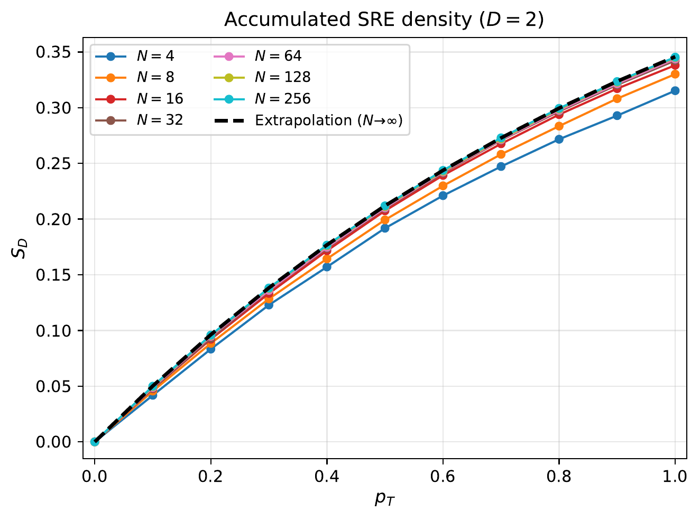
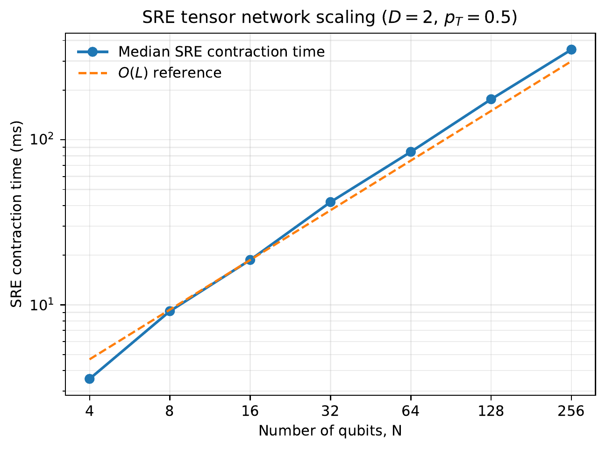

# ⚛️ Quantum Magic in Clifford+T Circuits Using MPS

Julia simulations of quantum magic in shallow random circuits using **matrix product states (MPS)** and **replica tensor network contractions**.

---

## 🧠 Why Quantum Magic?

Non-Clifford resources, including **T gates**, are essential for universal fault-tolerant quantum computation. **Quantum magic** (nonstabilizerness) characterizes how far a quantum state is from the class of efficiently simulable stabilizer states.

We quantify magic using the second stabilizer Renyi entropy (SRE):

$$
S_2(|\psi\rangle) = -\log_2\left[\frac{1}{2^N}\sum_{P\in\mathcal{P}_N}\langle\psi|P|\psi\rangle^4\right],
$$

where $\mathcal{P}_N$ denotes the $N$-qubit Pauli strings. For pure states, SRE is **zero exactly for stabilizer states** and **invariant under Clifford operations**, making it a useful measure of state magic.

## ⚙️ Tensor Network Method

We simulate **two-layer random Clifford+T brickwork circuits** with open boundaries using [ITensors.jl](https://github.com/ITensor/ITensors.jl) and [ITensorMPS.jl](https://github.com/ITensor/ITensorMPS.jl).

Following the replica approach of [Haug and Piroli (2023)](https://doi.org/10.1103/PhysRevB.107.035148), this implementation evaluates SRE through a **four-replica MPS contraction** rather than explicitly summing over all $4^N$ Pauli strings. We use no deliberate MPS truncation and validate small-system results against direct state-vector calculations.

For fixed MPS bond dimension, contraction costs grow linearly with qubit number, although they can increase rapidly with bond dimension.

## 📊 Numerical Results

### Magic generation versus T-gate density



Here $p_T$ is the probability of inserting a T gate at each eligible location. The plotted **accumulated SRE density** is

$$
S_D = \frac{1}{ND}\sum_{d=1}^{D} S_2(|\psi_d\rangle), \qquad D=2.
$$

It sums the SRE after each layer, rather than showing only the final-state SRE. The curves use **2,000 random circuit realizations per parameter setting**, with $N=4$ to $256$ and a thermodynamic-limit extrapolation.

### Computation time versus system size



At $D=2$ and $p_T=0.5$, the **median final-layer SRE contraction time** grows approximately linearly up to 256 qubits. Timings are taken from realizations 2 through 2,000 (excluding the first to reduce warm-up effects). This benchmark is for **fixed shallow depth and bounded bond dimension**, not arbitrary deep circuits; absolute runtimes depend on the hardware and Julia runtime.

## 🔗 Connection to Quantum Resource Estimation

For even $N$, T gates are inserted independently with probability $p_T$. With the two outer qubits excluded from T-gate insertion in the second layer, the **expected number of inserted T gates** is

$$
\mathbb{E}[N_T] = (2N-2)p_T.
$$

This connects a controllable **non-Clifford gate budget** to the resulting **state magic**. SRE is not itself T-count or a fault-tolerant resource estimate. Studying T-depth, magic-state distillation, and logical overhead would be natural next steps.

## 🛠️ Run the Code

**Requirements:** Julia 1.12, `ITensors`, and `ITensorMPS`. Install dependencies:

```bash
julia -e 'using Pkg; Pkg.add(["ITensors", "ITensorMPS"])'
```

Example run:

```bash
julia sre_mps_poc.jl --L 16 --depth 2 --pT 0.5 --samples 100 --out results/example --dense-check false
```

The script produces a per-layer CSV and a metadata file. Run `julia sre_mps_poc.jl --self-test` to validate the implementation against small-system calculations.

## 📚 Reference

T. Haug and L. Piroli, [*Quantifying nonstabilizerness of matrix product states*](https://doi.org/10.1103/PhysRevB.107.035148), **Physical Review B 107**, 035148 (2023).
